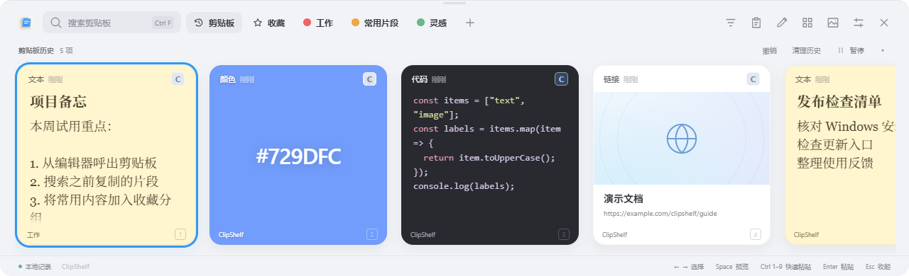
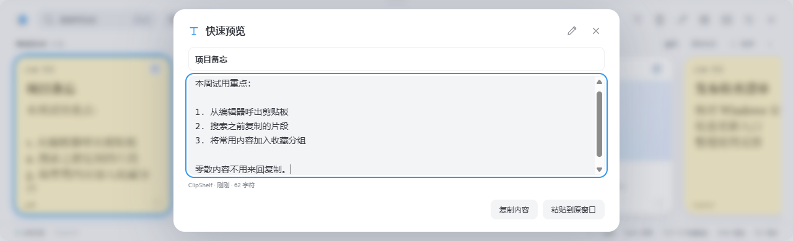

# ClipShelf

[简体中文](README.md) · English

ClipShelf is a Paste-inspired clipboard manager for Windows. A keyboard shortcut brings back the text and images you copied earlier. Your history is encrypted on your device, with no cloud sync.

**[Download for Windows x64](https://github.com/khalil-wei/ClipShelf/releases/latest)**



## Features

- **Search and filter history:** Keep copied text and images, then filter by type, time, or source. Code, links, and colors get their own card previews.
- **Preview and edit:** Inspect long text or images before pasting. Edit text and rename items.
- **Favorites and groups:** Keep frequently used items easy to find and group them by purpose.
- **Keyboard shortcuts and paste queues:** Paste back into the original app, or queue several items and paste them one at a time.
- **In-app updates:** The Rust/Tauri version can check for, verify, and install updates.

## Quick start

1. Download the Windows x64 installer ZIP from [Releases](https://github.com/khalil-wei/ClipShelf/releases/latest), extract it, and run setup. WebView2 is required.
2. Press `Ctrl+Shift+V` from the app you want to paste into and type to search your history.
3. Select an item and press `Space` to preview it, or press `Enter` or double-click to paste it.

If you are upgrading from 0.5.9 or earlier, quit ClipShelf from the system tray and install 0.6.0 or later manually once. After that, use **Preferences → About and Updates**.



## Run from source

The current Windows version uses Rust and Tauri and lives in `rust/`. Development requires Node.js, the Rust GNU toolchain, MinGW-w64, and WebView2.

```powershell
cd rust
npm ci
npm run dev
```

If MinGW-w64 is not in the sibling `tools/mingw64/bin` directory, set `CLIPSHELF_MINGW_BIN` to its `bin` path. Run `npm test` from `rust/` to run the tests.

Report bugs on [GitHub Issues](https://github.com/khalil-wei/ClipShelf/issues) or see the [contribution guide](CONTRIBUTING.md). ClipShelf is available under the [MIT license](LICENSE).
