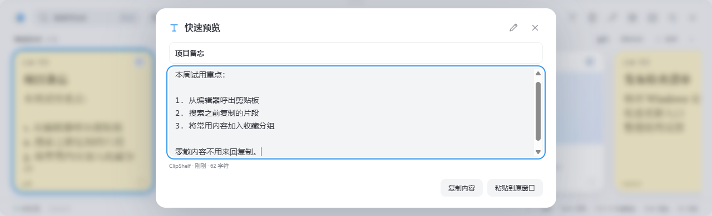

# ClipShelf

简体中文 · [English](README.en.md)

ClipShelf 是一款受 Paste 启发的 Windows 剪贴板工具。按一个快捷键，就能找回之前复制过的文字和图片。历史在本机加密保存，没有云同步。

**[下载 Windows x64 版](https://github.com/khalil-wei/ClipShelf/releases/latest)**


## 主要功能

- **历史搜索与筛选**：记录文字和图片，按关键词搜索，也可按类型、时间或来源筛选。代码、链接和颜色有各自的卡片预览。
- **快速预览与编辑**：查看长文本或图片，也可编辑文本、重命名片段。
- **收藏与分组**：收藏常用片段，按用途分组，之后可以直接找到。
- **快捷粘贴**：在原应用中呼出面板并粘回选中的内容，也可以用队列按顺序逐条粘贴。
- **应用内更新**：Rust/Tauri 版可检查更新、验证更新包并安装。

## 快速开始

1. 在 [Releases](https://github.com/khalil-wei/ClipShelf/releases/latest) 下载 Windows x64 安装 ZIP，解压后运行安装程序。需要 WebView2。
2. 在要粘贴的应用里按 `Ctrl+Shift+V` 呼出面板，输入关键词就能查找历史。
3. 选中片段后按 `Space` 预览，按 `Enter` 或双击粘贴。

从 0.5.9 或更早版本升级时，先从托盘退出旧版，再手动安装一次 0.6.0 或更新版本。之后可在「偏好设置 → 关于与更新」里更新。



## 从源码运行

当前 Windows 版的 Rust/Tauri 代码在 `rust/`。开发需要 Node.js、Rust GNU 工具链、MinGW-w64 和 WebView2。

```powershell
cd rust
npm ci
npm run dev
```

如果 MinGW-w64 不在项目同级的 `tools/mingw64/bin`，将 `CLIPSHELF_MINGW_BIN` 设为实际的 `bin` 路径。在 `rust/` 运行 `npm test` 执行测试。

欢迎在 [Issues](https://github.com/khalil-wei/ClipShelf/issues) 反馈问题，或查看[贡献指南](CONTRIBUTING.md)。项目采用 [MIT 许可证](LICENSE)。
